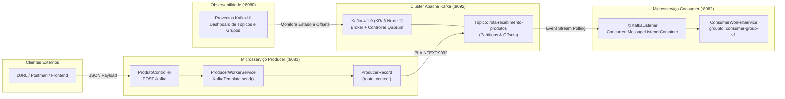

# 🚀 Kafka Mini Project — Event-Driven Architecture com Apache Kafka & Spring Boot

<div align="center">


-231F20?style=for-the-badge&logo=apachekafka&logoColor=white)


<p align="center">
  <b>Sistema distribuído orientado a eventos (EDA) modular com Apache Kafka 4.1 em modo KRaft nativo (sem ZooKeeper), microsserviços Spring Boot 3/Java 21 desacoplados e painel de observabilidade em tempo real com Kafka-UI.</b>
</p>

</div>

---

## 📌 Visão Geral

Esse projeto é uma implementação de referência de arquitetura distribuída baseada em mensageria assíncrona orientada a eventos (*Event-Driven Architecture*). O projeto foi concebido para demonstrar a ingestão, publicação e consumo de mensagens em tópicos do **Apache Kafka 4.1.0**.

A aplicação é dividida em dois microsserviços autônomos construídos com **Spring Boot** e **Java 21**:
- **`producer`**: expõe uma API REST HTTP para receber requisições de envio de dados e publica `ProducerRecord`s diretamente no tópico de destino no cluster Kafka.
- **`consumer`**: escuta reativamente o tópico via `@KafkaListener` utilizando um *Consumer Group* dedicado, processando e logando as mensagens de forma assíncrona e desacoplada.

---

## 🏗 Arquitetura do Sistema

O fluxo de dados segue o padrão de desacoplamento temporal e espacial entre serviços produtores e consumidores:



### Fluxo de Execução dos Eventos:
1. Uma requisição HTTP `POST` contendo o tópico (`route`) e a carga útil (`content`) chega ao `ProdutoController` na porta `8081`.
2. O `ProducerWorkerService` instancia um `ProducerRecord` e o despacha para o broker através do `KafkaTemplate<String, String>`.
3. O Kafka persiste o registro no tópico `rota-recebimento-produtos` atribuindo uma partição e um offset sequencial.
4. O `ConsumerWorkerService` (porta `8082`), registrado com o grupo `consumer-group-v1`, consome continuamente o registro e processa o seu conteúdo.
5. Toda a volumetria, lags de consumidores e tópicos podem ser auditados visualmente no **Kafka-UI** em `http://localhost:8080`.

---

## 🛠 Stack Tecnológica

| Componente | Tecnologia | Versão | Descrição |
| :--- | :--- | :--- | :--- |
| **Linguagem** | Java | 21 (LTS) | Utilização de registros (`records`), pattern matching e performance moderna da JVM |
| **Framework** | Spring Boot | 3.x / 4.x | Ecossistema base com Spring Web e Spring for Apache Kafka |
| **Mensageria** | Apache Kafka | 4.1.0 | Event streaming distribuído operando em modo KRaft nativo |
| **Orquestração** | Docker Compose | v2+ | Provisionamento declarativo de containers do broker e ferramentas |
| **Observabilidade** | ProvectusLabs Kafka-UI | Latest | Interface web para métricas de tópicos, consumidores e brokers |
| **Build & Deps** | Apache Maven | 3.9+ | Gerenciamento multi-módulo (`pom.xml` raiz agregando `producer` e `consumer`) |
| **Utilitários** | Project Lombok | - | Redução de boilerplate (`@RequiredArgsConstructor`, etc.) |

---

## 📁 Estrutura do Projeto

O repositório adota o padrão **Maven Multi-Module**, permitindo compilação unificada e ciclo de vida independente para cada serviço:

```text
kafka/
├── docker-compose.yml              # Cluster Kafka (KRaft) + Kafka-UI
├── README.md                       # Documentação técnica de referência
└── kafka/                          # Raiz do projeto Maven Multi-Módulo
    ├── pom.xml                     # POM pai agregador (gerencia dependências e submódulos)
    ├── mvnw / mvnw.cmd             # Maven Wrapper (Linux e Windows)
    ├── producer/                   # Módulo Microsserviço Producer (Porta 8081)
    │   ├── pom.xml
    │   └── src/main/
    │       ├── java/producer/
    │       │   ├── ProducerApplication.java
    │       │   ├── config/
    │       │   │   └── KafkaProducerConfig.java    # Configuração de ProducerFactory e KafkaTemplate
    │       │   ├── controller/
    │       │   │   └── ProdutoController.java      # REST Controller (POST /kafka)
    │       │   ├── dto/
    │       │   │   └── ProdutoDTO.java             # Java 21 Record (route, content)
    │       │   └── service/
    │       │       └── ProducerWorkerService.java  # Envio para o cluster Kafka
    │       └── resources/
    │           └── application.properties          # Porta 8081, logs e bootstrap servers
    └── consumer/                   # Módulo Microsserviço Consumer (Porta 8082)
        ├── pom.xml
        └── src/main/
            ├── java/consumer/
            │   ├── ConsumerApplication.java
            │   ├── config/
            │   │   └── KafkaConsumerConfig.java    # ConsumerFactory e ConcurrentKafkaListenerContainerFactory
            │   ├── dto/
            │   │   └── ProdutoDTO.java             # Java 21 Record compartilhado
            │   └── service/
            │       └── ConsumerWorkerService.java  # @KafkaListener (consumer-group-v1)
            └── resources/
                └── application.properties          # Porta 8082 e conexões do broker
```

---

## 🚦 Guia de Execução Passo a Passo

### Pré-requisitos
- **Java JDK 21+** instalado e configurado no `PATH` (`java -version`).
- **Docker** e **Docker Compose** instalados e em execução (`docker compose version`).
- Conexão de internet ativa para download das imagens e dependências Maven.

---

### Passo 1: Subir o Cluster Kafka & Kafka-UI (Docker)

Na raiz do projeto (onde reside o arquivo `docker-compose.yml`), execute:

```bash
# Iniciar o container do Kafka (KRaft) e o Kafka-UI em segundo plano
docker compose up -d
```

Verifique se os containers subiram com sucesso:

```bash
docker compose ps
```

*Saída esperada:*
```text
NAME       IMAGE                         COMMAND                  SERVICE    CREATED          STATUS          PORTS
kafka      apache/kafka:4.1.0            "/opt/kafka/bin/kafk…"   kafka      10 seconds ago   Up 10 seconds   0.0.0.0:9092->9092/tcp
kafka-ui   provectuslabs/kafka-ui:latest "/bin/sh -c 'java --…"   kafka-ui   10 seconds ago   Up 10 seconds   0.0.0.0:8080->8080/tcp
```

> [!NOTE]
> O Kafka inicializa em **modo KRaft** com `CLUSTER_ID` pré-configurado e listener PLAINTEXT anunciado em `localhost:9092`. O cluster está imediatamente pronto sem a necessidade de esperar sincronização de ZooKeeper.

---

### Passo 2: Executar o Microsserviço Producer

Abra um novo terminal, navegue até a pasta `kafka/` e inicie a aplicação Spring Boot do Producer:

```bash
# No Linux / macOS:
./mvnw spring-boot:run -pl producer

# No Windows (PowerShell / CMD):
.\mvnw.cmd spring-boot:run -pl producer
```

Aguarde o log de inicialização indicar que o servidor Tomcat está ativo:
```text
Tomcat started on port 8081 (http) with context path '/'
Started ProducerApplication in 2.345 seconds
```

---

### Passo 3: Executar o Microsserviço Consumer

Abra outro terminal, navegue até a pasta `kafka/` e execute o Consumer:

```bash
# No Linux / macOS:
./mvnw spring-boot:run -pl consumer

# No Windows (PowerShell / CMD):
.\mvnw.cmd spring-boot:run -pl consumer
```

O log indicará a inscrição bem-sucedida do consumidor no tópico:
```text
Tomcat started on port 8082 (http) with context path '/'
Subscribed to topic(s): [rota-recebimento-produtos]
Started ConsumerApplication in 2.112 seconds
```

---

## 📡 Guia da API REST (Producer)

O Producer expõe o endpoint HTTP para publicação de mensagens em tópicos do Kafka.

### Especificação do Endpoint

- **URL:** `http://localhost:8081/kafka`
- **Método HTTP:** `POST`
- **Cabeçalhos:** `Content-Type: application/json`

#### Corpo da Requisição (`RequestBody`):

```json
{
  "route": "rota-recebimento-produtos",
  "content": "Notebook Dell XPS 15 - Código SKU: 884729"
}
```

| Campo | Tipo | Obrigatório | Descrição |
| :--- | :--- | :--- | :--- |
| `route` | `string` | Sim | Nome do tópico de destino no Apache Kafka |
| `content` | `string` | Sim | Mensagem ou carga útil de dados a ser transmitida |

#### Resposta de Sucesso:
- **Status Code:** `202 Accepted`
- **Corpo:**
  ```text
  Produto 'Notebook Dell XPS 15 - Código SKU: 884729' enviado com sucesso pela rota 'rota-recebimento-produtos'
  ```

---

### Exemplos Práticos de Envio

#### Via cURL (Bash / Linux / macOS / Git Bash):
```bash
curl -X POST http://localhost:8081/kafka \
  -H "Content-Type: application/json" \
  -d '{
    "route": "rota-recebimento-produtos",
    "content": "Monitor UltraWide LG 34 - Pedido #5521"
  }'
```

#### Via PowerShell (Windows):
```powershell
Invoke-RestMethod -Uri "http://localhost:8081/kafka" `
  -Method POST `
  -Headers @{ "Content-Type" = "application/json" } `
  -Body '{"route": "rota-recebimento-produtos", "content": "Placa de Video RTX 4070 - Pedido #9921"}'
```

---

### O que acontece nos bastidores?

1. **No terminal do Producer (Porta 8081):**
   ```text
   Mensagem enviada com sucesso!
   Tópico: rota-recebimento-produtos
   Partition: 0
   Offset: 1
   ```

2. **No terminal do Consumer (Porta 8082):**
   ```text
   Received product message: Monitor UltraWide LG 34 - Pedido #5521
   ```
 ---

 PROJETO FEITO COMO BASE DE ESTUDO PARA ENTENDER MELHOR A APLICAÇÃO E FUNCIONAMENTO DO KAFKA !
